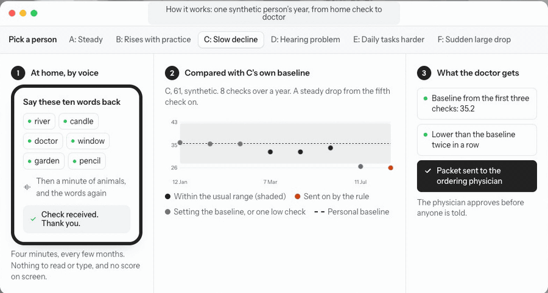

# Spoken memory check

A four-minute memory check that an adult does at home by voice, in Gulf Arabic or English. Each check is compared with that person's own earlier checks and read alongside the risk factors in their screening record: blood pressure, blood sugar, cholesterol, mood, hearing and, only with consent, family history and genes.

The person gets plain prevention steps of their own. Their physician gets a packet, treatable causes first, only when two checks in a row average about 9.5 points below the person's baseline, the scores fall steadily, or the person says everyday tasks have got harder. Results are given in person.

Why speech: many older adults in the Gulf had little schooling, and a test that needs reading, typing or tapping is unfair to them. Saying words back and naming animals is how memory has been tested by phone for decades. An open speech model on the device writes down the words recalled and the animals named, and the check counts them.

**Live: https://spoken-memory-check.vercel.app** (no sign-up). Try it in 30 seconds:

1. Open the page in Chrome and choose "Try it with your voice": say three words, then name animals for 20 seconds.
2. No microphone? Choose "Play a recorded check".
3. Choose "A year of checks", then open the physician's packet and approve it through to a closed referral.

A prototype for Abu Dhabi's adult screening programme, built for Statement 8 of the Future Health challenge, "Protecting Brain Health Earlier". It does not diagnose. The people and histories in the demo are synthetic and labelled.

## Statement 8, item by item

The statement lists six things a solution should do. This is where each one is in the live demo.

| Statement 8 asks for | What this check does | See it | Not yet |
|---|---|---|---|
| Culturally valid and accessible assessment | Spoken in Gulf Arabic or English, with nothing to read or type, so schooling and eyesight matter less. A hearing check (digits in noise) comes first. The speech model runs on the device, phones included. | [Try it with your voice](https://spoken-memory-check.vercel.app/#/try), [Hearing check](https://spoken-memory-check.vercel.app/#/hearing) | The Arabic word lists have no native Gulf reviewer yet. |
| Longitudinal change detection | Three checks set a personal baseline. Each later check is compared with it after practice and measurement error. Lower once means check again; two checks well below, or a steady fall, go to a physician; a very large fall goes the same day. | [A year of checks](https://spoken-memory-check.vercel.app/#/year) | The measurement error comes from published studies, not our own retest. |
| Integrated risk context | With consent, the physician's packet shows ten of the fourteen Lancet risk factors from the screening record (blood pressure, HbA1c, LDL, mood, hearing, vision, activity, smoking, BMI, schooling), plus family history and APOE from the Emirati Genome Programme, each behind its own consent. | [The physician's packet](https://spoken-memory-check.vercel.app/#/clinician) | The record has no sleep data. Each check asks "I slept badly or feel unwell today", and the packet raises sleep apnoea. |
| Personalized prevention and timely care | The person's own page lists, in plain words, what their screening visit shows they can work on. The packet puts treatable causes first (B12, thyroid, mood, hearing, sleep apnoea, medicines), then refers to neurology, geriatric medicine or audiology on a 15-working-day clock. | [What the person sees](https://spoken-memory-check.vercel.app/#/me) | The prevention wording awaits the public health centre's approval. |
| Safety and human oversight | It flags risk and never diagnoses. Scores are ranges with stated limits, no score is shown at home, and a physician approves every routine packet before anyone is told. | [One case, both screens](https://spoken-memory-check.vercel.app/#/story) | No physician has reviewed the packet yet. |
| Validation and local population performance | The Evidence page covers all seven measures the statement names (completion, retest reliability, sensitivity, specificity, meaningful change, false-referral burden, time to assessment), split by language, age and schooling, each marked measured, simulated or not yet. | [Evidence](https://spoken-memory-check.vercel.app/#/benchmark) | No patients or older Emirati volunteers yet. A pilot measures the rest. |

## For judges: what is measured

| | |
|---|---|
| Arabic words heard right | On the device: 93% of 720 real single words from 30 adults, with the speaker's own voice as the answer key (82% for the on-device model alone; 40% before tuning). Lab test of MBZUAI and Inception's Jais-ASR: 97.1% alone, 99.2% with own voice, as a proposed optional UAE-hosted listener. Read words from adult volunteers of unstated age. `docs/TEMPLATE_BENCH.md`, `docs/JAIS_ASR_BENCH.md` |
| Older speakers | Measured on public data, not yet on volunteers: on Saudi TV speech labelled by age and dialect (SADA, 83 older and 200 adult Gulf clips), word error was 31% for older against 33% for adult Gulf speakers with Jais-ASR, and 68% against 75% with the on-device model. Neither listener heard older Gulf voices worse. `docs/OLDER_SPEAKERS_BENCH.md` |
| Where it fits | The memory step of Thiqa's "Comprehensive hearing and dementia screening" packages 52-45 and 52-46 (IFHAS 3.0, Addendum 06), which name no memory tool. `docs/COMMERCIAL.md` |
| Hand-off | FHIR R4 with 0 errors from the official HL7 validator 7.0.5; referral as the HL7 v2 REF message with SNOMED specialty that Malaffi asks for (Circular 2026/144). `docs/FHIR_VALIDATION.md` |
| Fairness | Real US survey data: a fixed animal cutoff flags 48% of healthy adults with under 9 years of school against 16% of graduates. `analysis/`. In the Gulf, the usual MoCA cut-off classed 69.3% of 606 older adults in Dubai and Sharjah as impaired (Issa et al. 2026). Simulated: among stable simulated members who start in the lowest fifth, one cut-off for everyone falsely flags 69% in a year and this rule 1.7%. |
| Validation | The statement's seven measures (completion, retest, sensitivity, specificity, meaningful change, false referrals, time to assessment) by language, age and schooling, each marked measured, simulated or not yet, on the Evidence page. |
| Flag rule | Simulated: two routes (two checks in a row well below baseline, and a steady slow fall). 5.2% false alarms a year; flagged within the year: 52% of simulated members losing 1 point a check, 97% losing 2. `scripts/benchmark.ts` |
| Quality | 240 automated tests run every line of the decision code (672 of 672) and catch 92% of 1,026 deliberate bugs put into the rules (mutation testing). After each deploy a headless browser runs the live site end to end: every screen, the consent lock, both recorded checks scored on the device and checked word by word against what the voice said, and a packet to a closed referral (5 of 5 steps passed); a second run feeds a computer voice in as the microphone and passes in English and Arabic. 0 accessibility violations in 48 axe checks. `scripts/live-check.ts`, `docs/ACCESSIBILITY.md` |
| Safety | Speech is scored on the device by default; no audio leaves it unless the person turns on the browser's recogniser. The person is never shown a score. Family history and genome results reach the physician only with their own consent, as context the rule never reads. A physician approves every routine packet before the person is contacted, and results are given in person; only a very large fall sends the person straight to urgent care. A missed or unheard check is never counted as low. The full check stays locked until the person agrees. Every person-facing screen reads at grade 4 or under (English). No language model makes any decision. `docs/SAFETY_CASE.md`, `docs/COMPLIANCE.md` |
| Who pays | Thiqa's screening packages 52-45 and 52-46. Modelled running cost: about AED 26 per eligible member a year at 40% uptake. No partner has agreed yet. `docs/COMMERCIAL.md` |
| Rules | Compliance map, intended use, risk register. `docs/COMPLIANCE.md`, `docs/INTENDED_USE.md`, `docs/RISK_REGISTER.md` |

To run it yourself: `npm install`, then `npm run dev`. To redeploy: `scripts/deploy.sh` (uploads only the built files).

## What it does

- **Listeners that stay on the device.** By default an open speech model running on the device scores the speech, and word recall is also matched against the person's own voice from when they said each word back; no audio leaves the device. The browser's recogniser, which may send audio to the browser's maker, joins only if the person turns it on. A word heard by two is confirmed, so every score is a range.
- **Compared with yourself.** The first three checks set a baseline. A later check counts as low only after the expected practice gain and the measurement error are taken into account, and a flag needs two checks in a row that together sit well below the baseline, or a steady fall.
- **Three other routes.** A reported change in everyday tasks goes to the physician whatever the score. A failed sound check holds the check instead of scoring it low. A very large fall sends the person to urgent assessment.
- **A physician decides.** The ordering physician approves, edits or dismisses a packet: the trajectory, treatable contributors first, and the risk factors the screening record already holds. After approval the app only invites the person to a visit.
- **Nobody lost.** The referral is tracked to closure against a 15-working-day target, and a programme view counts every member by facility.
- **Hearing first.** A three-minute digits-in-noise hearing check, answered by tapping, runs before the memory check. A fail becomes an audiology referral, and a weekly one-tap question tracks whether the hearing aid is worn.
- **People check the machine.** One recorded check in ten is scored again by a person who cannot see the machine's result, and agreement is tracked by language.
- **Lost signals.** The programme view lists every abnormal brain-relevant screening result with no recorded action by its target date (simulated year).
- **No language model anywhere.** Fixed rules in code make every decision.

## Evidence

- Real data: in a public US health survey (NHANES 2011 to 2014, 3,110 adults aged 60 and over), a fixed cutoff of 14 animals flags 48% of adults with under 9 years of school who report no memory problem, against 16% of graduates. `analysis/`
- Simulation of the flag: 5.2% false alarms a year in stable simulated members (4.9% with the previous rule, 3.4% with the first rule); flagged within the year: 52% of members losing one point a check (45% with the previous rule) and 97% losing two; at an assumed 2% of members in real decline, about 70 packets per 1,000 members a year, 19 of them real. Same settings throughout. `npx tsx scripts/benchmark.ts`
- Real recordings: on 720 real single Arabic words from 30 adults, the first on-device model heard 40%; an Arabic-tuned model with near-miss matching heard 82%; adding each speaker's own voice as the answer key raised it to 93% (speaker interval 91 to 95%), with 0.8% wrong words credited. English: 62% of 387 words. Public adult datasets, read words, not older or Gulf speakers. `docs/HUMAN_SPEECH_BENCH.md`, `docs/TEMPLATE_BENCH.md`
- Smaller Arabic model: the decoder's word table stored at 4 bits cuts the Arabic download from 299 MB to 165 MB, served from this site, with no loss on the 720 real clips (83% against 82%). `docs/HUMAN_SPEECH_BENCH.md`
- Older and Gulf speakers, public data: on Saudi TV speech labelled by age and dialect (SADA), word error for older Gulf speakers against adult Gulf speakers was 31% vs 33% for Jais-ASR and 68% vs 75% for the on-device model. Neither heard older Gulf voices worse; Gulf speech was harder than other dialects for both. TV sentences, not a memory check. `docs/OLDER_SPEAKERS_BENCH.md`
- Tested code: mutation testing put 1,026 small deliberate bugs into the decision rules one at a time, and the tests caught 940 (92%); most of the rest change only wording. `npx stryker run`
- 240 automated tests: `npm test`. Cases listed in `docs/TESTED_CASES.md`. They run all 672 lines of the decision code and 95% of its branches; the rules that decide what happens to a person are covered on every branch. `npx tsx scripts/coverage-summary.ts`
- Live end to end: after each deploy, `scripts/live-check.ts` opens the live site in headless Chromium, opens every screen, checks the full check stays locked until the person agrees, scores the recorded check in English and Arabic on the device, checks every credited and missed word against what the voice said, and takes one packet to a closed referral with the HL7 and FHIR files. A second run (`scripts/mic-check.ts`) starts Chromium with a computer voice as its microphone and takes "Try it with your voice" through the sound check and 20 seconds of animals: 8 animals credited in English and 8 in Arabic, each one the voice said; with silence as the microphone the sound check fails and nothing is scored. No person has used the microphone path yet.
- Plain language: every screen the person reads and every spoken prompt measures at Flesch-Kincaid grade 4 or under in English (guidance for patient material asks for 6 to 8). Arabic is not graded. `npx tsx scripts/reading-grade.ts`

## Documents

- `docs/JUDGES.md`: where to find the evidence for each criterion
- `docs/LIMITS.md`: assumptions, dependencies and limits
- `docs/PILOT.md`: pilot design, size, costs, stop rules, stages
- `docs/SAFETY_CASE.md`: hazard log
- `docs/DATA_SOURCES.md`: every data source and the right to use it
- `docs/SCORING_RULES.md`: how animal naming is scored
